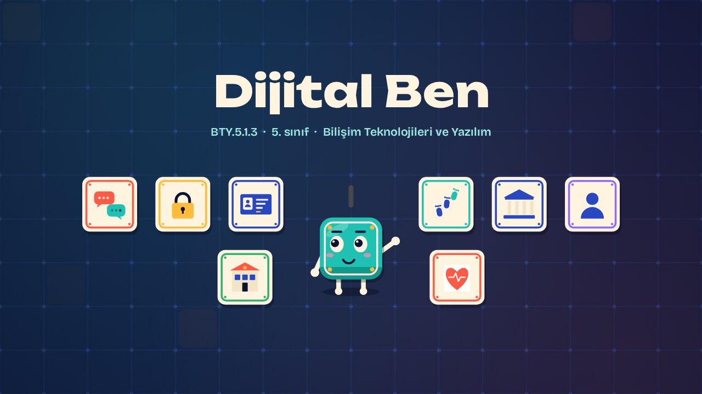
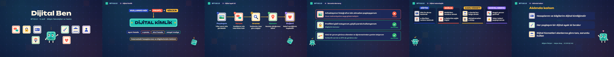

# Dijital Ben · Digital Me

**▶ Tarayıcıda izleyin / Watch in the browser:** https://hakanatas.github.io/dijital-ben/ 
**⬇ MP4 + altyazılar / MP4 + subtitles:** [Releases](https://github.com/hakanatas/dijital-ben/releases) 
**✎ Kullanılan istem / The prompt behind it:** [PROMPT.md](PROMPT.md) 
**🎞 Bütün filmler / All films:** [Bilişim Filmleri](https://hakanatas.github.io/bilisim-filmleri/?sinif=5)

> **TR —** 5. sınıf Bilişim Teknolojileri ve Yazılım dersinin "Bilişim Teknolojilerinin Hayatımızdaki Yeri" temasındaki BTY.5.1.3 öğrenme çıktısı için hazırlanmış, tamamen JavaScript ile çizilen 2,4 dakikalık animasyon; ses efektleri ve hafif fon müziği de kodla üretilir. Karo internetteki hesaplarına bakarak dijital kimliğini tanır: kullanıcı adı, profil bilgileri ve gizlilik ayarları. Paylaşım, yorum, arama, konum ve beğenilerin geride bıraktığı dijital ayak izleri ve bu izlerin etkileri (kalıcılık, reklamlar, konumun bilinmesi) adım adım izlenir. Sorumlu ve saygılı çevrim içi davranışlar değerlendirilir; sorun olduğunda aile, öğretmen, rehberlik servisi ve BTK'dan yardım istenebileceği hatırlatılır. Son olarak dijital vatandaşlık uygulamaları (EBA, e-Okul, MHRS, e-Nabız, e-Devlet, sosyal medya) kullanım alanlarına göre gruplandırılır. Altyazılar Türkçe, İngilizce ya da ikisi birlikte seçilebilir.

A 2.4-minute animation, with code-generated sound, for **5th-grade IT and Software** (Türkiye Yüzyılı Maarif Modeli). Karo meets his digital identity (username, profile, privacy settings), follows the digital footprints left by sharing, commenting, searching, location and likes, judges responsible online behaviour, and groups digital citizenship services by area. The guide is **Karo**, a living glazed tile who never speaks: he tells the story with his face, his arms and the blinking cursor above his head.

## Öğrenme çıktısı · Learning outcome

MEB, Türkiye Yüzyılı Maarif Modeli, Bilişim Teknolojileri ve Yazılım Dersi Öğretim Programı, 5. sınıf, 1. tema "Bilişim Teknolojilerinin Hayatımızdaki Yeri":

**BTY.5.1.3. Dijital vatandaşlık uygulamalarını sınıflandırabilme**
- a) Dijital kimlik kavramını belirler.
- b) Dijital ayak izinin etkilerini bilişim teknolojilerinin kullanım alanları ile ilişkilendirir.
- c) Dijital vatandaşlık uygulamalarını kullanım alanlarına göre gruplandırır.

## Sahneler · Scenes

| # | Zaman | Sahne | Ne oluyor | Çıktı |
|---|---|---|---|---|
| 1 | 0:00–0:16 | Giriş |  |  |
| 2 | 0:16–0:46 | Dijital kimlik | Kullanıcı adı, profil bilgileri ve gizlilik ayarları dijital kimliği oluşturur. | a |
| 3 | 0:46–1:15 | Dijital ayak izi | Paylaşım, yorum, arama, konum ve beğeni izleri ve etkileri. | b |
| 4 | 1:15–1:38 | Sorumlu davranış | Çevrim içi davranışlar sorumlu ya da riskli diye değerlendirilir; yardım kaynakları. | b |
| 5 | 1:38–2:09 | Dijital vatandaşlık | EBA, e-Okul, MHRS, e-Nabız, e-Devlet ve sosyal medya uygulamaları alanlarına ayrılır. | c |
| 6 | 2:09–2:24 | Aklında kalsın |  |  |

## Çalıştırma · Running it

- **Önizleme:** `index.html` dosyasına çift tıklayın (çevrim dışı da çalışır). Klavye: boşluk oynat/duraklat, ← → 3 sn, Home başa. Adrese `?altyazi=en`, `?bicim=vertical` ya da `?ses=0` eklenebilir.
- **MP4:** bir kez `npm install`, sonra `npm run export -- --format=both --captions=tr` (720p yatay ve dikey, sesli). Google Chrome yüklüyse Playwright onu kullanır (`channel: 'chrome'`); ffmpeg gerekir.
- **Altyazı ve seslendirme notları:** `npm run srt` → `out/dijital-ben_tr.srt`, `_en.srt`, `_tr-en.srt`, `_seslendirme-notlari.txt`.
- **Sürüm dosyaları:** `npm run release` → `release/` klasöründe v1.0'ın 6 dosyası.
- **Yazı kontrolü:** `npm run check` yatay ve dikey düzende, üç altyazı seçeneğiyle üst üste binen, kenardan taşan ya da 720p'de 17 pikselden küçük kalan yazı arar.
- **Düzenleme:** senaryo (sahneler, altyazılar, seslendirme notları) `scenes/film.js` içindedir; değiştirince `npm run build` süreleri, `captions.js` ve `film.config.js` dosyalarını yeniden üretir. Sahne şablonları `src/kit/`, Karo `src/draw/karo.js`, ses `src/audio/synth.js`.

Her kare `renderFrame(t)` ile zamanın saf fonksiyonu olarak çizilir; rastgelelik tohumludur, MP4 ekran kaydı değil kare kare üretimdir. Ses de dosyadan çalınmaz: aynı olay listesinden hesaplanır. Yazı tipleri: Unbounded ve Bricolage Grotesque (SIL OFL 1.1), dosyaya gömülü.

## Lisans · License

**TR —** Bu film ve kodu [Creative Commons Atıf-GayriTicari 4.0 Uluslararası (CC BY-NC 4.0)](https://creativecommons.org/licenses/by-nc/4.0/deed.tr) lisansıyla paylaşılır. Ticari olmayan her amaçla (derste, okulda, eğitim materyalinde) kopyalayabilir, paylaşabilir ve değiştirebilirsiniz; ancak **kaynak göstermek zorunludur**: eser sahibinin adı ve bu deponun bağlantısı belirtilmeden kullanılamaz. Ticari kullanım (satış, ücretli ürün ya da yayın) için izin alınmalıdır.

**EN —** This film and its code are licensed under [Creative Commons Attribution-NonCommercial 4.0 International (CC BY-NC 4.0)](https://creativecommons.org/licenses/by-nc/4.0/). You may copy, share and adapt them for non-commercial purposes, but **attribution is required**: they may not be used without crediting the author and linking to this repository. Commercial use requires permission.

Atıf örneği / Required credit: *“Dijital Ben”, Hakan Ataş, Bilişim Filmleri — https://github.com/hakanatas/dijital-ben — CC BY-NC 4.0*
